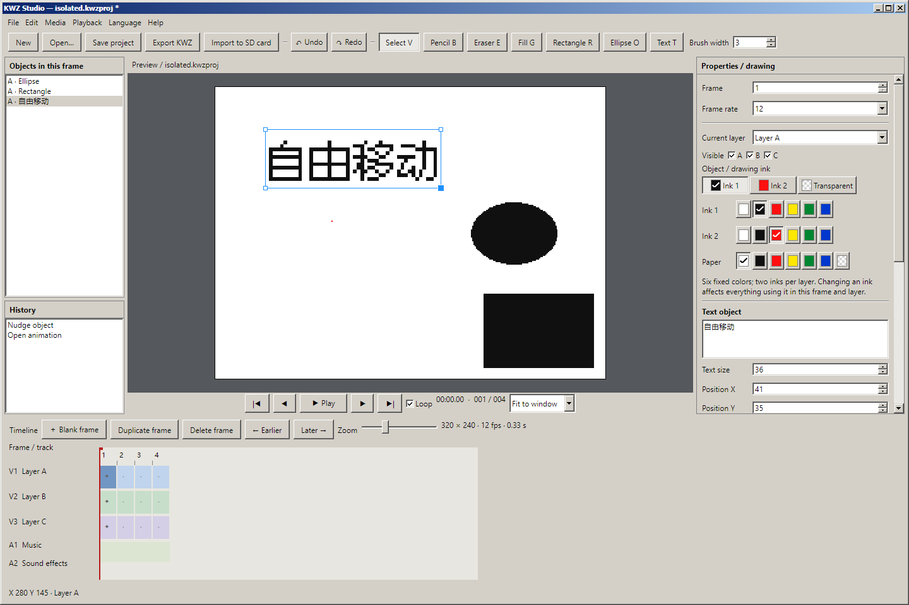
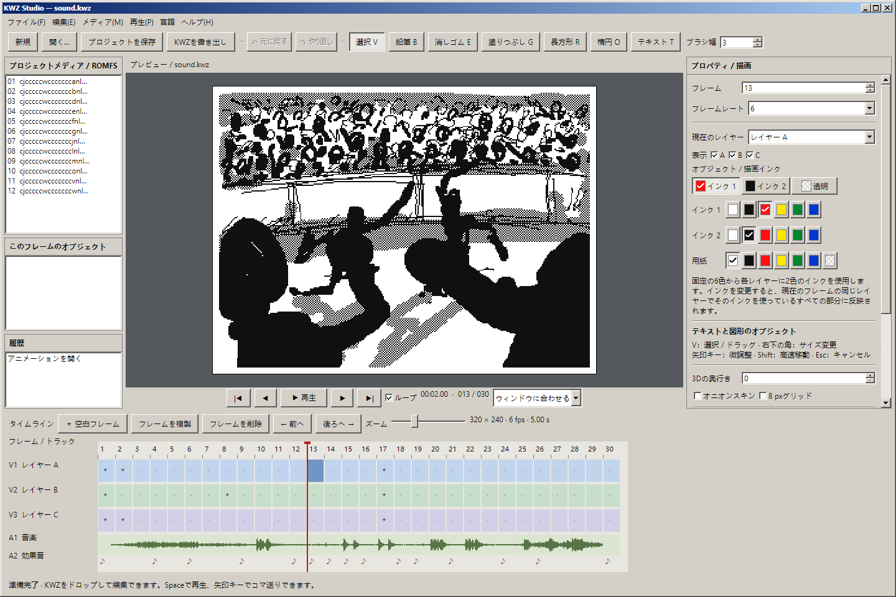
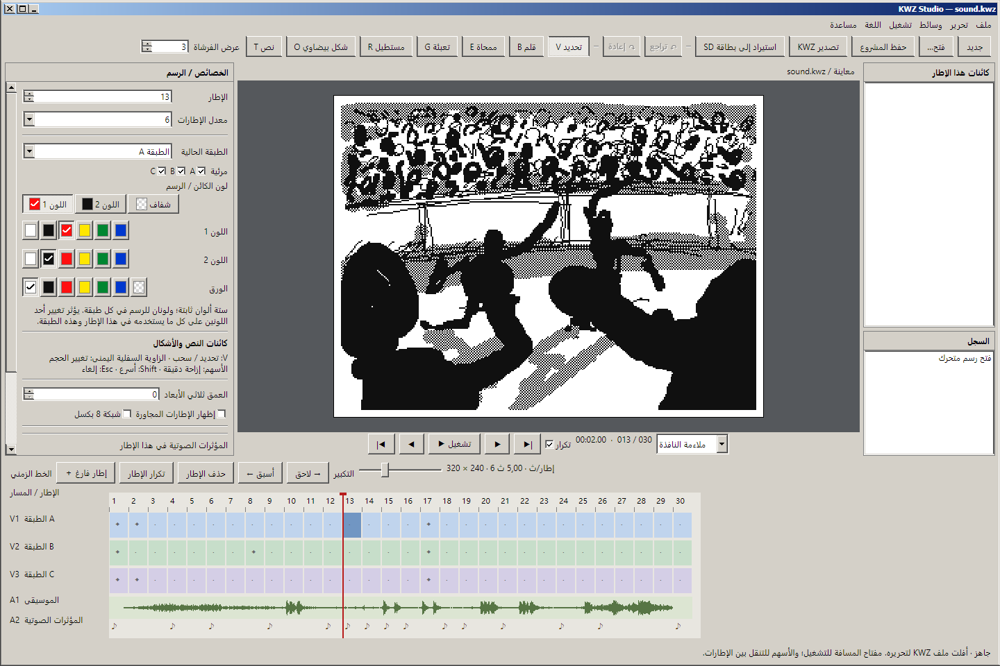

# libkwz

A .NET 8 library for reading, editing and writing the animation KWZ files used by Flipnote Studio 3D.

## Lossless roundtrip

```csharp
using LibKwz;

using var note = new KwzFile("input.kwz");
byte[] rebuilt = note.ToArray();
// Or: note.Save("output.kwz");
// For an unchanged valid input, rebuilt is byte-for-byte identical to the input.
```

`KwzFile` reads/writes KFH, KTN, KMC, KMI and KSN, preserving section order, unknown sections,
UTF-16 code units, filenames, unused metadata, JPEG bytes, compressed audio, alignment and the
256-byte signature. Section lengths and CRC32 values are regenerated on write.

KMC is rebuilt by decoding each layer to indexed pixels and re-encoding the pixels with the original
instruction choices. This includes opcode choice, common/general row references, type-7 pattern
selection, skip-run boundaries and unused bits. It does not return a cached copy of the original file.
Multiple legal streams can represent the same image, so exact byte preservation requires this encoding
plan. `KwzLayerEncoding.Read(...).ToBytes()` also supports lossless reconstruction of a single layer.

## Decode and edit

```csharp
using var note = new KwzFile("input.kwz");
byte[] pixels = note.FrameData.DecodeFrame(5);
// Three 320x240 layers, concatenated A/B/C. Values: 0 transparent, 1 first ink, 2 second ink.
int x = 100, y = 100, layer = 0;
pixels[layer * 320 * 240 + y * 320 + x] = 1;
note.FrameData.SetFramePixels(5, pixels);
note.Save("edited.kwz");
```

`DecodeFrame` returns an independent buffer, supports arbitrary frame order, and decodes hidden layers.
The historical optional `diffingFlag`/`isPrevFrame` parameters remain source-compatible, but decoding
always returns all three layers. Iterative replay follows actual skip instructions, avoiding recursion
and dependence on metadata optimization hints.

`SetFramePixels` compresses the replacement against its predecessor and repairs the following frame's
delta stream so that later frames keep their original appearance. Layer sizes, dependency flags, section
alignment and CRCs are updated. Metadata is editable through `Header` and `Meta.Entries`.
Writing a header preserves its filename fields; call `Header.RegenerateFilenames()` explicitly if needed.
Setting identical pixels or identical raw audio is a no-op and preserves the original encoding.

## Creating and editing animations

```csharp
using var note = KwzFile.CreateBlank(frameCount: 12, framesPerSecond: 24);
byte[] layer = note.FrameData.DecodeLayer(0, 0); // 320 x 240, values 0/1/2
layer[100 * 320 + 100] = 1;
note.FrameData.SetLayerPixels(0, 0, layer);
note.FrameData.DuplicateFrame(sourceIndex: 0, destinationIndex: 1);
note.FrameData.InsertBlankFrame(2);
note.FrameData.MoveFrame(sourceIndex: 0, destinationIndex: 3);
note.FrameData.DeleteFrame(2);
note.UpdateThumbnail(frameIndex: 0);
```

All frame indices are zero-based. Insert/duplicate destinations are positions before insertion;
`MoveFrame` takes the final destination index. Deleting the last remaining frame is rejected.
`RemapFrames([4, 0, 4, -1])` builds a timeline from existing frames; `-1` inserts a blank frame.
Remapping rebuilds delta dependencies, clones frame metadata, follows the thumbnail-frame index,
and preserves other sections and opaque extensions. Only a few decoded frames are held at once.
An identity remap leaves the original file bytes unchanged. A blank frame inherits the first frame's
palette/depth but has no sound-effect triggers or camera flags. Existing BGM data and timing settings
are retained; frame sound-effect triggers travel with their frames.

`UpdateThumbnail` explicitly regenerates the JPEG from a selected frame, retaining existing thumbnail
dimensions (80 x 64 for newly created files). Ordinary saving does not regenerate it. The compatibility
image collections refresh when palette, depth, or visibility metadata changes; previously returned
cached images are disposed during refresh. Prefer owned `FrameToImage` results in editors.
JPEG thumbnails use the standard KWZ palette and composite transparent paper over white.

`FrameData.RecompressFrames()` discards the old encoding choices and performs fresh compression with
inter-frame skip runs. Pass `false` to encode independent frames. `KwzLayerCodec.Encode` and `Decode`
operate on individual layers. All valid tile types (0, 1, 2, 3, 4, 5 and 7) are supported; reserved type 6,
invalid row indexes and truncated streams are rejected.

For images, use `FrameToImage(index)` and dispose every returned layer and composite. Compositing honors
paper color, layer visibility, depth and A-over-B-over-C ordering at equal depths. Legacy `DecodedFrames`
and `CompositeFrames` collections are generated only when requested; dispose the note to release them.
For low memory use, process one frame at a time instead of accessing these collections.

`Sound.GetAudioTrack(track)` returns little-endian PCM16; `GetAudioTrackRaw`/`SetAudioTrackRaw` access the
five ADPCM tracks. The PCM encoder is lossy and a partial final byte can add up to three padding samples.
Unchanged tracks retain their original compressed bytes for exact roundtrips.
`Sound.SetAudioTrack(track, pcm16)` encodes and replaces mono PCM16 at 16,364 Hz; it does not resample.
Track indices are 0 for BGM and 1–4 for the four sound effects. Modified audio receives fresh alignment
and CRC values without changing the other tracks.

## Validation and safe saving

Use `new KwzFile(path, verifyChecksums: true)` to reject bad CRC32 values in KFH/KTN/KMC/KSN.
The default reader remains permissive for compatibility and records original mismatches in
`OriginalChecksumErrors`. CRC validation and RSA signature verification are separate checks.
Unknown sections have no assumed checksum scheme.

`Save` serializes before touching the destination, writes one temporary file alongside it, flushes it,
then replaces the destination. Serialization errors and failed replacements leave the destination
intact, and the temporary file is removed. Returned arrays and streams can also be used for fully
in-memory processing. Library instances and their mutable metadata are not thread-safe.

## Desktop editor

[KWZ Studio](editor/README.md) is the Avalonia editor built on this library, using the existing
Classic.Avalonia.Theme package. Run `editor/start.cmd` after building. Save editable text and shapes in
self-contained `.kwzproj` projects, then export signed game KWZs using the embedded signing resource. See the editor README for drawing, timeline, audio, and keyboard controls.

The main workspace combines a frame preview, layer timeline, audio waveform, and drawing properties.


Text and shapes remain editable objects that can be selected, moved, and resized before KWZ export.
New text objects use the bundled **Fusion Pixel** font at 24 px (2× its native 12 px size), with no
system font installation required. Existing project objects keep their saved font choice.



Studio includes **20 UI languages**: English, Simplified and Traditional Chinese, Japanese, Korean,
French, German, Spanish, Italian, Brazilian Portuguese, Russian, Ukrainian, Polish, Dutch, Turkish,
Arabic, Hindi, Indonesian, Vietnamese, and Thai. Choose a language from the **Language** menu;
changes apply immediately and the preference is remembered. The first launch follows the system
language, with English as the fallback. Switching languages preserves your project and undo history.
Arabic uses a right-to-left interface while the artwork and timeline retain their original coordinates.

<details>
<summary>Studio in Japanese and Arabic</summary>





</details>

Translation catalogs are embedded in the app; no language downloads are needed.
See [the localization guide](editor/LOCALIZATION.md) for message resources and validation.

## Signature and scope

An unchanged body retains the original RSA signature. Editing pixels or metadata changes the signed body.
By default the library preserves the trailer. Use `SaveSigned` or `ToSignedArray` to generate a
fresh RSA-2048/SHA-256/PKCS#1 v1.5 signature using the binary resource embedded in the library:

```csharp
using var note = new KwzFile("input.kwz", verifyChecksums: true);
note.Header.CurrentAuthorName = "中文汉化";
note.SaveSigned("edited.kwz");
bool valid = note.VerifySignature();
```

The private key (`src/Resources/KwzSigningKey.der`, 1,192 bytes) and matching public key
(`KwzVerificationKey.der`, 270 bytes) are compiled into the assembly as `EmbeddedResource` items.
No executable path, sidecar key file, environment variable, or runtime extraction is required.
`KwzSigning.Sign(bytes)` and `Verify(bytes)` use these resources directly. `CreateSigningKey()` and
`CreateVerificationKey()` return independently owned `RSA` instances; callers must dispose them.
Explicit `RSA` overloads on `ToArray`, `WriteTo`, `Save`, `Sign`, and `Verify` remain available.
`VerifySignature` verifies the current serialized state; use `KwzSigning.Verify` on the original bytes
to check an untouched on-disk file.
After serialization, `SignatureMatchesOriginalBody` reports whether the body is unchanged, **not** whether
a signature is cryptographically authentic.

The analyzed game executable contains the complete matching RSA private key. Re-signing is therefore
possible: the research verifier reproduced the signature bytes of all 24 romfs KWZ files exactly and
verified new signatures over modified data. See [the signing investigation](research/kwz-signing.md)
for binary offsets, Ghidra findings, and a reproducible check that reads the key from a local executable
as historical evidence of the key discovery. The library itself reads only its embedded resources. This corrects the previous claim that new signatures could not be generated.
Hardware/emulator playback of modified animations has not been tested here.

The file reader targets complete animation KWZs with KFH/KMI/KMC and a 256-byte trailer. Folder-icon KIC
files and unsigned fragments are outside this API. CRCs are recalculated on write, so byte identity is
promised for valid inputs, not deliberately incorrect checksums. Newly edited frames do not automatically
regenerate the embedded JPEG thumbnail; use `UpdateThumbnail` or replace `Thumbnail.Data` explicitly.

## Verification

Run from the library directory with the .NET 8 SDK or newer:

```powershell
dotnet test test/LibKwz.Test/LibKwz.Test.csproj
dotnet run --project test/LibKwz.Verify -- <NOTE_PROJECT>
```

Tests find the Note project by walking up from the test executable; set `KWZ_CORPUS_ROOT` for another
location. The integration corpus includes both unpacked romfs versions, top-level KWZs, the existing
kwz-parser samples, and the two existing test fixtures. The full integration suite requires this external
corpus. The repository includes `test.kwz` and `sound.kwz` as test fixtures, plus the two small DER key
resources; the ROM and remaining corpus files are not bundled.

For an independent oracle, download only the 88 KB parser bundle, compare all original/recompressed/edited
files, and remove the bundle even when verification fails:

```powershell
$referencePath = Join-Path $env:TEMP ('libkwz-reference-' + [guid]::NewGuid() + '.cjs')
try {
    Invoke-WebRequest 'https://cdn.jsdelivr.net/npm/flipnote.js@6.3.0/dist/cjs/KwzParser.cjs' -OutFile $referencePath
    dotnet run --project test/LibKwz.Verify -- <NOTE_PROJECT> $referencePath verification-report.json
    if ($LASTEXITCODE -ne 0) { throw 'KWZ verification failed' }
} finally {
    Remove-Item -LiteralPath $referencePath -ErrorAction SilentlyContinue
}
```

Signing checks use the embedded private key; the independent Node verifier reads the public DER resource.
The game executable is not required.
It handles one file at a time. KWZ output and decoded media remain in memory; the external oracle
receives each KWZ through stdin and returns SHA-256 hashes and an independent Node crypto signature
result. No frame PNGs, audio WAVs or duplicate KWZ corpus are generated. `verification-report.json`
retains per-file and per-frame evidence, including signed edits and remapped timelines.

Validated on 2026-10-25: **34 files, 1,634 frames, 4,902 layers, 8,449,336 input bytes**. All 24 romfs files
from v6.1.0 and v7.2.0 are included. Every reconstructed file is byte-identical. Every indexed frame and
PCM track matches flipnote.js 6.3.0; freshly recompressed files and edited frames with unchanged successors
also pass the independent decoder. All seven valid tile types occur in the corpus. **70 tests pass** in Release,
including backwards seeks, first/middle/last-frame edits, cross-block skip runs, malformed input,
noncanonical compression, opaque metadata and rendering rules. New tests cover signing, blank animation
creation, layer-only edits, timeline insert/delete/duplicate/reorder, metadata cloning, explicit thumbnails,
strict CRC reads, audio replacement, refreshed image caches, and failed/atomic saves. Independent validation
also checks signed edited/remapped files and newly created animations. All 34 sample signatures are valid
and are reproduced exactly by the embedded game key.

Regression run on 2026-10-26: **77 library tests and 220 Studio checks pass**, including the corrected
palette/transparent-paper JPEG export, all 20 embedded language catalogs, live language switching,
RTL layout, language preferences, bundled Fusion Pixel rendering, saved-font compatibility, and
preservation of unsaved projects and undo/redo history.

The image API remains on the compatible ImageSharp 3.1 branch (3.1.12). NuGet still reports security
advisories for this dependency; these warnings are not suppressed. Moving to ImageSharp 4 is a separate
API/licensing migration. The checks above establish format and editing behavior for the supplied corpus,
not the safety of decoding arbitrary hostile image payloads or compatibility with every hardware path.

The local committed baseline was verified against [LITTOMA/libkwz commit 64eb082](https://github.com/LITTOMA/libkwz/commit/64eb08201e4d408beb259e3b4d14b1b130a20ca5).
The pre-existing local sound implementation and tests were incorporated into this work.

## License

The original code and documentation in libkwz and KWZ Studio are licensed under
the [MIT License](LICENSE).

Bundled fonts and third-party dependencies retain their own licenses; see
[Studio font notices](editor/Fonts/README.md). Nintendo game content and
game-derived resources are not relicensed by this project's MIT License.

## References

- [Flipnote Collective KWZ format research](https://github.com/Flipnote-Collective/flipnote-studio-3d-docs/wiki/KWZ-Format)
- [Independent flipnote.js decoder by James Daniel](https://github.com/jaames/flipnote.js/blob/master/src/parsers/KwzParser.ts)

The codec implementation follows the format research already cited by this project. The independent
JavaScript decoder is downloaded temporarily for validation and is not bundled with the library.
