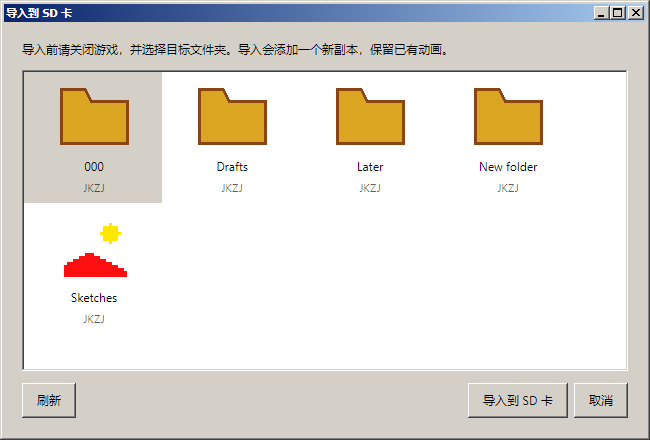
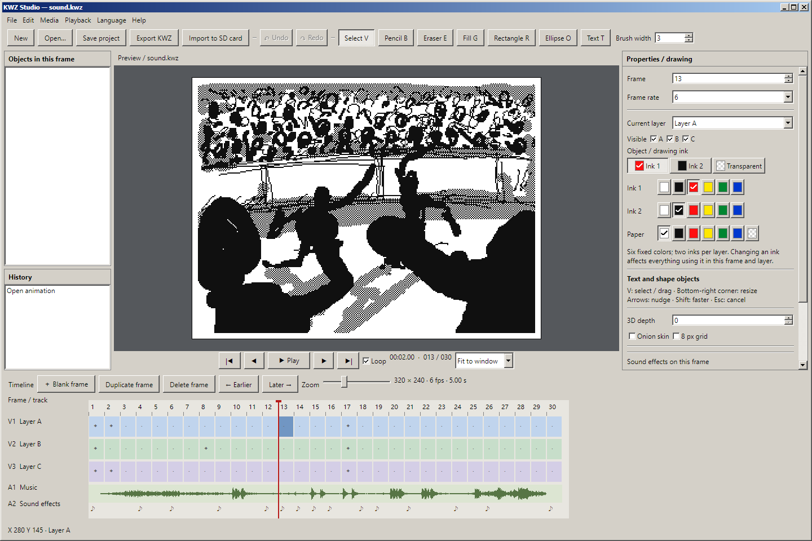

# KWZ Studio

用于创作和编辑 KWZ 动画的独立 Windows 桌面编辑器，基于 Avalonia 11.3.22 和现成的
[Classic.Avalonia.Theme 11.3.0.3](https://github.com/BAndysc/Classic.Avalonia)。
窗口、菜单、按钮、输入框、滚动条使用该主题；画面和时间线是应用自己的编辑控件。

## 运行

双击 `start.cmd`，或运行 `bin/Release/net8.0/win-x64/KwzStudio.exe`。
需要 .NET 8 x64 运行时。整个输出目录应放在一起，不能只复制 exe。
可以把 KWZ 或 `.kwzproj` 工程拖进窗口，也可以把文件路径作为启动参数。
不带文件参数启动时创建空白工程。只有通过启动参数、打开文件或拖入文件才加载作品；
不会搜索上级工程、扫描周围目录或自动打开示例。左侧显示当前帧的对象及操作历史。

打开原始 KWZ 后开始编辑，使用 **保存工程（Ctrl+S）** 保存为 `.kwzproj`。
工程是独立的压缩文件，包含底图、原有音频和元数据，以及所有可编辑文字和形状；移动工程时无需携带原始 KWZ。

完成后使用 **导出 KWZ（Ctrl+Shift+E）**。导出会合成对象、更新缩略图和校验和，
再使用 libkwz 内置的 DER 资源签名。默认导出文件名带 `_edited`，工程里的对象与底图仍可继续编辑。
导出不会将尚未保存的工程标记为已保存。工程保存和 KWZ 导出均先写同目录临时文件，成功后替换目标，失败后清理临时文件。

## 导入到 3DS 的 SD 卡

先退出主机上的游戏，将 SD 卡连接电脑。首次导入或使用 **文件 → 选择 SD 卡…** 时，
只选择 SD 卡根目录（模拟器则选择 `sdmc`），不选择其中的作品文件夹。
这个根目录保存在本机的 `sd-import.json` 中；旧版保存的作品文件夹会自动转换为所属卡的根目录。

**每次点击“导入到 SD 卡”都会重新选择目标文件夹**。选择器按文件夹名称和游戏设置的 `!.ico`
图标显示作品文件夹，并附地区代码；不显示冗长的完整路径。图标缺失或损坏时使用通用文件夹图标。
游戏创建的自定义名称、空文件夹同样可以选择，不要求已有 `!!.lst`。
打开选择器、切回选择器或点击 **刷新** 时重新读取目录和图标；确认导入前也会检查目标是否仍存在。
已选文件夹被删除时会取消选择，需要重新选择目标，不会自动导入到其他文件夹。
如果卡上尚无作品文件夹，请先在主机的游戏中创建一个。导入成功后，状态栏显示新文件的位置，再安全弹出 SD 卡。



导入会合成文字/形状、重新生成缩略图、签名，并登记到 `!!.lst`，让新副本排在列表首位。
文件名符合游戏规则，重名时自动生成另一个名字，保留全部已有作品和原有排序；每个文件夹最多 100 个作品。
工程内容、未保存状态和撤销历史保持不变。损坏列表会停止导入，不会自动重建覆盖。

更新前，原列表备份为同目录下的 `!!.lst.studio-<随机编号>.bak`，每份最多约 7 KB。
备份不会复制动画。写入完成会回读核对；列表替换失败时清除新副本，保留原列表。
需要恢复列表时，先关闭游戏，再将对应备份还原为 `!!.lst`。实现和研究见 [SD 列表格式](../research/SD-LIST.md)。
已通过游戏原始 ARM 算法交叉验证和临时目录导入测试；尚未进行实机/Citra 中完整导入播放验证。

## 界面语言

在“语言 / Language”菜单中即时切换语言，无需重启。支持简体中文、繁体中文、英语、日语、韩语、法语、德语、西班牙语、意大利语、巴西葡萄牙语、俄语、乌克兰语、波兰语、荷兰语、土耳其语、阿拉伯语、印地语、印尼语、越南语和泰语。

首次启动跟随系统语言，不支持的语言回退到英语；选择后保存到 `%LOCALAPPDATA%/KWZ Studio/settings.json`。选择“跟随系统语言”可恢复自动选择。切换时保留当前动画、可编辑对象、未保存修改及撤销历史，不翻译作品内的文字或作者名。

阿拉伯语界面采用从右向左布局，画布及时间线保持原始坐标和帧顺序。工具栏可换行以适应长译文。菜单、属性、帮助、操作历史及编辑器自身的错误提示均已翻译；系统文件选择器及底层库原始诊断仍由操作系统或相应组件提供。翻译维护说明见 [LOCALIZATION.md](LOCALIZATION.md)。



## 编辑

- 三层像素编辑：画笔、橡皮、填充。文字、矩形、椭圆作为独立对象编辑。
- 新建文字对象默认使用内置“缝合像素体”12px 比例版，默认字号24px；无需安装字体。已有工程保留对象原先指定的字体。
- 对象选择、自由拖动、右下角缩放、精确坐标、文字内容与字号、形状尺寸、实心/轮廓、线宽、颜色和图层。
- 左侧“本帧对象”列表；对象复制、删除、撤销重做；帧复制和移动会同时携带对象。
- 色块选色器：每帧每层的两种墨色、纸张颜色、图层深度，以及整个动画的图层可见性。
- 时间线逐帧定位、空白帧插入、复制、删除、前后移动；撤销和重做。
- 洋葱皮、8 像素网格、画面缩放、时间线缩放。
- 导入 PNG/BMP/JPG 到当前图层，按当前颜色量化；导出合成画面 PNG。
- 背景音乐波形、四组音效触发、同步声音播放、循环播放和帧率设置。
- 导入 PCM16 / Float32 WAV，自动混为单声道并转换到 16,364 Hz；导出背景音乐 WAV。

选择 T 文字工具，在右侧输入内容后点击画面创建对象。R 拖出矩形，O 拖出椭圆。
按 V 或点击左侧对象列表选中对象，然后直接拖动；拖右下角蓝色方块缩放。
选中后右侧可修改文字、字号、坐标、形状尺寸、填充和线宽。
方向键每次移动 1 像素，Shift+方向键移动 10 像素；Esc 取消正在拖动的操作或取消选择。
Delete 删除选中的对象，Ctrl+D 复制对象；未选中对象时这两个快捷键操作当前帧。

文字与形状不会立即写入底图。移动或删除对象会完整露出原来被遮挡的像素，保存重开工程后仍然如此。
若需要用橡皮或画笔修改对象本身，可以“合并到像素”，并可用撤销恢复。KWZ 每层只有两种墨色及透明像素，
对象也遵循该限制。只打开导出的 KWZ 会得到像素图像；继续编辑对象应打开 `.kwzproj`。

右侧“对象 / 笔色”显示当前图层的两种实际墨色与透明选项；选择后用于绘画，或修改选中的文字/形状。
下方点击“墨色 1 / 2”的色块为该墨色选色，勾号表示当前选择，悬停显示颜色名称与十六进制值。
这些按钮可用 Tab 聚焦、方向键切换，修改颜色支持撤销重做。
修改墨色会改变**当前帧、当前图层所有使用该墨色的像素与对象**；其他帧及图层的调色板保持原样。
纸张单独选色，棋盘格表示透明。图层透明像素会露出下层或纸张。

KWZ 的固定调色板为白 `#FFFFFF`、黑 `#101010`、红 `#FF1010`、黄 `#FFE700`、绿 `#008631`、蓝 `#0038CE`。
文件保存调色板索引，不能写入任意 RGB 值；因此选色器提供这些实际可用颜色。
颜色值与 libkwz 的 `KwzMeta.FramePalette` 一致。

| 操作 | 快捷键 |
| --- | --- |
| 播放 / 暂停 | 空格 |
| 上一帧 / 下一帧（未选中对象） | 左 / 右方向键 |
| 对象微调 / 加速微调 | 方向键 / Shift+方向键 |
| 首帧 / 末帧 | Home / End |
| 选择 / 画笔 / 橡皮 / 填充 / 矩形 / 椭圆 / 文字 | V / B / E / G / R / O / T |
| 撤销 / 重做 | Ctrl+Z / Ctrl+Y |
| 复制 / 删除对象或当前帧 | Ctrl+D / Delete |
| 新建 / 打开 / 保存工程 | Ctrl+N / Ctrl+O / Ctrl+S |
| 工程另存为 / 导出 KWZ | Ctrl+Shift+S / Ctrl+Shift+E |

撤销历史保存在内存中，最多 100 个状态，并限制约 32 MiB 的压缩数据；单个大文件至少保留两个状态。
声音预览和音频导入目前限制在 10 分钟以内。该版本面向单个 KWZ 动画，不提供多素材视频合成、
视频导出。工程格式说明见 [PROJECT-FORMAT.md](PROJECT-FORMAT.md)。声音实际输出及修改文件在 3DS/模拟器内的播放仍需实机验证。

## 构建与验证

安装 .NET 8 SDK 或更高版本后，在此目录运行 `build.ps1`。脚本的包缓存与中间下载位于项目内的
临时目录，成功或失败后均清除；保留可运行的 Release 输出。

```powershell
dotnet run --project ../test/KwzEditor.Smoke -c Release -- ..
```

交互验证使用 Avalonia.Headless 加实际 Skia 渲染，执行色块选色/撤销/键盘操作/颜色导出、鼠标绘制、对象创建/移动/缩放、文字属性修改、
键盘微调、撤销重做、帧映射、独立工程重开、失败保存、格式版本拒绝、对象合并与恢复、
签名导出、WAV 导入导出，并检查原始样本未被修改。
本次检查记录在 `smoke-report.json`；`objects-preview.png` 为实际对象编辑界面渲染。
此前全部 34 个样本的混音已通过独立解码器比较，音频逻辑在本次修改中未改变。

底层库的 ImageSharp 3.1.12 依赖仍有 NuGet 安全公告，未隐藏构建警告；详见库 README。
